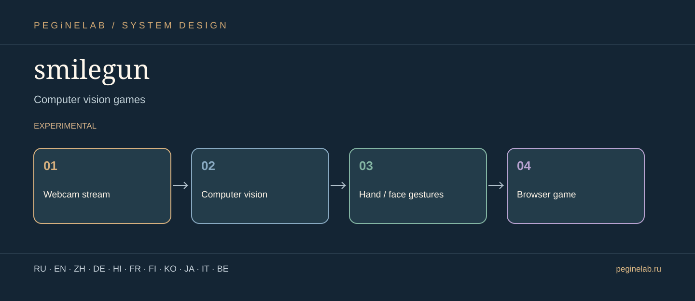

# smilegun — Visual project presentation

**Игры с компьютерным зрением · Computer vision games**

**Project flow:** Webcam stream → Computer vision → Hand / face gestures → Browser game. **Status:** experimental.

**Translations:** documentation showcase only; interface localization and actual device tests are described independently in this project's README.

### Русский · ru
Экспериментальная браузерная игра с управлением жестами и камерой.. **smilegun:** Webcam stream → Computer vision → Hand / face gestures → Browser game.

### English · en
Experimental browser game controlled through camera gestures.. **smilegun:** Webcam stream → Computer vision → Hand / face gestures → Browser game.

### 简体中文 · zh
使用摄像头手势控制的实验性浏览器游戏。. **smilegun:** Webcam stream → Computer vision → Hand / face gestures → Browser game.

### Deutsch · de
Experimentelles Browserspiel mit Kameragesten als Steuerung.. **smilegun:** Webcam stream → Computer vision → Hand / face gestures → Browser game.

### हिन्दी · hi
कैमरे के इशारों से नियंत्रित प्रयोगात्मक ब्राउज़र गेम।. **smilegun:** Webcam stream → Computer vision → Hand / face gestures → Browser game.

### Français · fr
Jeu expérimental dans le navigateur contrôlé par gestes et caméra.. **smilegun:** Webcam stream → Computer vision → Hand / face gestures → Browser game.

### Suomi · fi
Kokeellinen selainpeli, jota ohjataan kameran eleillä.. **smilegun:** Webcam stream → Computer vision → Hand / face gestures → Browser game.

### 한국어 · ko
카메라 제스처로 조작하는 실험적 브라우저 게임.. **smilegun:** Webcam stream → Computer vision → Hand / face gestures → Browser game.

### 日本語 · ja
コンピュータービジョンゲーム. **smilegun:** Webcam stream → Computer vision → Hand / face gestures → Browser game.

### Italiano · it
Giochi di visione artificiale. **smilegun:** Webcam stream → Computer vision → Hand / face gestures → Browser game.

### Беларуская · be
Гульні з камп'ютарным зрокам. **smilegun:** Webcam stream → Computer vision → Hand / face gestures → Browser game.

## Контакты / Contact

Telegram: [@Feudorlab1](https://t.me/Feudorlab1)

Email: [feudor.lab@yandex.ru](mailto:feudor.lab@yandex.ru), [obzorniky@gmail.com](mailto:obzorniky@gmail.com) · [peginelab.ru](https://peginelab.ru/)

[Repository](https://github.com/musikfed/smilegun) · Technical README is authoritative; experimental features are not certified.
